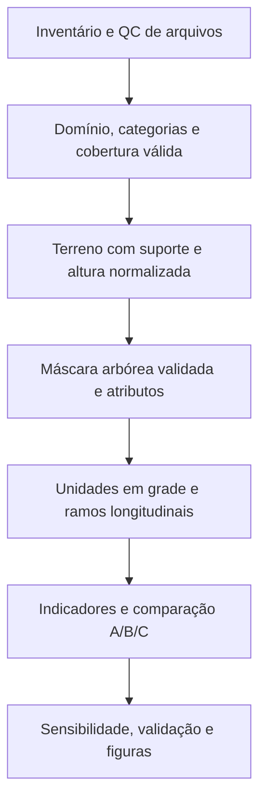

# Diagnóstico técnico e científico — LiDAR e corredores verdes de São Paulo

Data da auditoria: **25/10/2026**. Pesquisa proposta para o SBSR 2027.

## 1. Resumo executivo

**Veredito: viável com restrições.** Os dados sustentam um diagnóstico retrospectivo
de estrutura arbórea em 2020, nos perímetros da camada municipal atualizada em
2026, e uma comparação de representações 2D/3D. Ainda não sustentam afirmar
superioridade do método 3D, conectividade ecológica funcional ou eficácia das
intervenções municipais.

Foram encontrados **924 MDS e 924 MDT**, todos com cabeçalhos legíveis, nomes
consistentes e correspondência entre códigos. Os MDS somam **5.224.058.953**
registros e os MDT **675.411.102**. Os LAZ extraídos ocupam **40,50 GB**; os ZIPs
preservados acrescentam **40,47 GB**. A soma de registros dos dois produtos não
representa pontos independentes: há evidência de que o MDT reutiliza pontos do MDS.

As principais decisões antes da implementação são:

1. **Incluir a classe 3 entre as candidatas a vegetação arbórea.** Nas amostras,
   essa classe contém alturas de aproximadamente 2–10 m. Filtrar somente 4/5
   descartaria muitas árvores. Separar árvores de arbustos ainda exige validação.
2. **Tratar o MDT como produto de terreno, sem interpretar classe 8 como classe
   padrão de solo.** A hipótese de terreno é apoiada pela procedência do produto,
   pelas coincidências XYZ e pelo teste de alturas, não apenas pelo código LAS.
3. **Usar um único recorte e uma única máscara arbórea para comparar A/B/C.**
   Caso contrário, mudanças de classificação e de área se confundem com o ganho 3D.
4. **Resolver as unidades longitudinais antes de calcular lacunas.** Os 114
   registros correspondem a **476 partes poligonais**; não há eixo central fornecido.
5. **Separar margem de processamento de expansão da área do estudo.** Um buffer
   externo de 10 m amplia a área conjunta em 85,4% e requer 26 folhas adicionais.

Convenção deste relatório: **observado** identifica resultados dos arquivos;
**interpretação** é uma explicação sustentada, ainda sujeita a validação;
**proposta** é uma escolha para o experimento, não um resultado já obtido.

Escopo executado: inventário recursivo do projeto e do HD externo; cabeçalhos de
todos os LAZ; diretório de todos os ZIPs; leitura integral de seis pares de nuvens,
em blocos de 500 mil pontos; CRC dos 12 ZIPs correspondentes; inspeção vetorial e
testes amostrais de consistência. **Não foi implementado o pipeline científico,
executado o piloto proposto ou alterado qualquer dado original.**

## 2. Inventário dos dados

Raízes examinadas:

- Projeto: `/home/s299259068/Área de Trabalho/Projetos/2026/sbsr_lidar_2027`.
- Acervo: `/media/s299259068/TOSHIBA EXT/sbbr_lidar_2027`.

Foram inventariados **3.719 arquivos relacionados**, excluindo ambiente virtual,
caches e os próprios relatórios. Tamanhos abaixo são GB decimais.

| Conjunto e caminho | Quantidade | Volume/registros | CRS | Situação observada |
|---|---:|---|---|---|
| `files/corredor_verde/corredor_verde.shp` e auxiliares | 1 camada | 114 feições, 19 atributos | EPSG:31983 | Legível; 89 Polygon e 25 MultiPolygon |
| `files/quadricula_folha_mdt_mds_2020/…shp` e auxiliares | 1 camada | 5.401 quadrículas; 924 intersectam os corredores | EPSG:31983 | Legível |
| HD: `MDS_2020/MDS_<código>_1000.laz` | 924 | 36,757 GB; 5.224.058.953 pontos declarados | EPSG:31983 em 924/924 | Cabeçalhos legíveis; 6 arquivos lidos integralmente |
| HD: `MDT_2020/MDT_<código>_1000.laz` | 924 | 3,746 GB; 675.411.102 pontos declarados | EPSG:31983 em 924/924 | Cabeçalhos legíveis; 6 arquivos lidos integralmente |
| HD: `MDS_2020/<código>.zip` e `MDT_2020/<código>.zip` | 1.848 | 40,468 GB no conjunto | Herdado do conteúdo | Diretórios legíveis; CRC recalculado em 12 |
| Seleção `quadriculas_selecionadas.gpkg` | 2 cópias | 924 feições por cópia | EPSG:31983 | Cópias operacionais no projeto e HD |
| CSVs, código de download, testes e documentação | Demais arquivos | Inventariados individualmente | Conforme tipo | Material operacional; não é referência de validação |

O inventário individual está em `inventario_arquivos.csv`; detalhes por LAZ em
`cabecalhos_lidar.json`. Não há códigos ausentes, extras ou duplicados em relação
às 924 folhas esperadas; não há nomes LAZ inconsistentes. Cada ZIP contém um LAZ
cujo caminho extraído existe e cujo tamanho corresponde ao membro do ZIP.
Isso identifica representações arquivada/extraída do mesmo produto; não equivale
a verificação bit a bit de todo o acervo.

**Limite de integridade:** abrir cabeçalhos e diretórios ZIP não comprova
integridade de todos os pontos comprimidos. A leitura/CRC integral passou nos
12 arquivos amostrais; a comprovação dos demais deverá ocorrer na primeira
passagem de processamento. Não foram encontrados arquivos `.part`, ortofotos,
GeoTIFFs de terreno/superfície ou imagens de referência nas duas raízes examinadas.

### Geometria, atributos e categorias dos corredores

**Observado:** nenhum polígono inválido, vazio, nulo ou geometricamente duplicado;
nenhuma duplicação dos identificadores `cd_identif`/`cd_identi0`. Existem 476
partes; uma feição chega a 49 partes. Há 23 partes com menos de 25 m².

- Extensão UTM: X **316.348,065–361.540,174 m**; Y **7.363.977,189–7.412.548,769 m**.
- Soma das áreas das feições: **10.860.565,64 m²**; área da união: **10.734.510,57 m²**.
- Área por feição: mínimo **310,20 m²**, mediana **42.769,97 m²**, máximo
  **614.643,88 m²**.
- **43 pares** de feições têm sobreposição com área positiva; outro par apenas
  se toca. A soma das interseções par a par é **126.211,42 m²**. Ela não é igual à
  área contada em excesso na soma das feições, devido a sobreposições múltiplas.
- A soma dos perímetros é **974.330,94 m**. **Esse valor não é extensão linear de
  corredores** e não deve ser usado como tal.

| Campo(s) | Tipo lido | Resultado relevante |
|---|---|---|
| `cd_identif` | int32 | 114 IDs únicos e completos |
| `cd_identi0` | texto | 114 IDs únicos e completos; chave textual recomendada |
| `cd_corredo` | texto | 113 completos; ausente justamente no corredor existente |
| `tx_situaca` | texto | **113 PROPOSTO; 1 EXISTENTE** |
| `tx_tipo_pr` | texto | 100 CORREDOR VERDE; 11 CORREDOR POLINIZADOR; 1 CORREDOR; 1 CORREDOR ESCURO; 1 nulo |
| `nm_subpref` | texto | 27 valores distintos |
| `nm_corredo` | texto | Nulo em 113 registros; não serve de chave/nome universal |
| `qt_area_me`, `qt_extensa` | float64 | Nulos em 113 registros; extensão preenchida apenas no existente: 1.040 m |
| `dt_atualiz` | datetime64[ms] | 113 registros em 11/06/2026; 1 em 24/06/2026 |
| `tx_origem_`, `tx_instrum`, `tx_link_in`, `tx_acao_sv`, `tx_link_ac`, `nm_area_ve`, `tx_propost`, `tx_origem0`, `tx_observa` | texto | Procedência, descrição e vínculos administrativos; completude variável |

Todos os 19 atributos e seus tipos/nulos estão em `esquema_corredores.json`.
Os auxiliares `.shx`, `.dbf`, `.prj` e `.cst` estão presentes; `.cpg` não foi
encontrado. A leitura funcionou; codificação de caracteres deve ser registrada
nas futuras exportações.

O existente é **CO_BT_01_E**, Butantã USP/Previdência, cujo campo `cd_corredo` é
nulo. Agrupar apenas por esse campo pode eliminar silenciosamente o único
existente. Não há amostra para uma comparação inferencial equilibrada de
"existentes versus propostos". Corredores polinizadores/escuros também não devem
receber automaticamente a mesma meta de altura e cobertura dos demais.

### Cobertura espacial

**Observado:** **47.625,23 m²**, ou aproximadamente **0,444%** da união dos
corredores, ficam fora da grade fornecida: CO_MP_02, com 41.074,26 m², e CO_AD_01,
com 6.550,97 m². Isso é uma limitação espacial da grade em relação aos polígonos,
não uma falta de download entre os 924 códigos esperados.

A união dos envelopes XY dos MDS deixa **63.944,15 m²** dos corredores fora desses
envelopes, aproximadamente **0,596%**; no MDT, **64.112,79 m²**. Há parcelas
afetadas em CO_BT_03, CO_IP_05, CO_MP_02 e CO_AD_01. Envelopes são otimistas:
não detectam buracos internos, água ou ausência local de retornos. Portanto,
**não é correto declarar cobertura efetiva de 100%**.

Uma checagem em células de 2 m nos envelopes das seis folhas amostrais encontrou
células de corredor sem nenhum retorno, inclusive no MDS. Na 3312-431 foram
1.115 de 3.440 centros de células considerados no recorte do envelope. Esse
diagnóstico não é uma estimativa municipal nem um indicador de ausência de
árvores: inclui questões de água, suporte e recorte. Um raster de cobertura
efetiva precisa distinguir **sem observação**, **superfície observada sem
árvores** e **vegetação observada**.

## 3. Diagnóstico da classificação LiDAR

### Distribuição efetivamente contada

Seis pares foram escolhidos intencionalmente: **3312-431, 2444-151, 4436-432,
3213-451, 2442-261 e 3334-223**. A seleção combina o exemplo, extremos espaciais
entre folhas com mais de 2 milhões de pontos MDS e uma folha de tamanho mediano.
Não é amostragem probabilística representativa da cidade.

Foram lidos **31.346.656 pontos MDS** e **3.893.792 MDT**, aproximadamente 0,60%
e 0,58% dos respectivos totais declarados. As contagens abaixo são integrais
**nesses arquivos**, não globais.

| Classe | MDS: pontos | MDS: proporção | MDT: pontos | Interpretação inicial |
|---:|---:|---:|---:|---|
| 1 | 4.253.118 | 13,568% | 0 | Não classificado; pode conter vegetação/estruturas omitidas |
| 2 | 6.991.183 | 22,303% | 0 | Terreno no esquema LAS |
| 3 | 5.392.130 | 17,202% | 0 | Vegetação candidata; inclui alturas arbóreas |
| 4 | 3.491.810 | 11,139% | 0 | Vegetação candidata de maior altura |
| 5 | 1.026.845 | 3,276% | 0 | Vegetação candidata alta |
| 6 | 6.313.658 | 20,141% | 0 | Edificações segundo o rótulo de origem |
| 8 | 3.877.912 | 12,371% | 3.893.792 | Classe usada no produto de terreno; exige interpretação contextual |

Não apareceram classes 0/7 nem outras classes nesses 12 arquivos. Isso não
estabelece ausência nas outras folhas. A folha 2442-261 não apresentou classe 6;
essa ausência isolada pode refletir a paisagem, não é prova de erro.

Os formatos são homogêneos nos cabeçalhos: **MDS LAS 1.4/PF8**, com RGB, NIR,
intensidade, retornos e `user_data`; **MDT LAS 1.2/PF1**, sem RGB/NIR. Nos seis
pares, retornos respeitam o intervalo 1…número de retornos; flags synthetic,
key_point e withheld estão zerados, assim como overlap nos MDS amostrais.
Overlap zerado não demonstra ausência real de sobreposição de faixas de voo.

### O significado da classe 8

No esquema legado de LAS, 8 identifica ponto-chave de modelo; a classe padrão de
terreno é 2. Nos formatos modernos 6–10, 8 é reservado e ponto-chave é um flag.
Assim, o MDS PF8 preserva um uso de classe 8 que merece documentação do produtor.
As definições convencionais não autorizam converter todo código 8 em solo em
qualquer conjunto de dados. Ver [classificação ASPRS](https://lasformat.org/latest/02.00_definition.html#point-data-record-format-6)
e a [orientação oficial sobre formatos legados](https://doc.esri.com/en/arcgis-pro/latest/tool-reference/3d-analyst/classify-las-by-height.html).

**Evidência local:** na 3312-431, uma amostra sistemática de **10.128 pontos MDT**
teve correspondência XY em milímetros com o MDS em **100% dos casos**, e todos
esses pareamentos apresentaram **ΔZ = 0** na precisão armazenada. Os rótulos no
MDS foram 10.076 de classe 8, 27 de classe 1 e 25 de classe 6. Isso sustenta que o
MDT é um subconjunto geométrico/reclassificado do MDS **nessa amostra**, sem
provar inclusão exata de todos os pontos das 924 folhas nem perfeição do filtro.
Também mostra que a correspondência entre produtos não pode ser feita apenas
pelo valor da classe.

O [metadado oficial do MDT](https://metadados.geosampa.prefeitura.sp.gov.br/geonetwork/srv/resources/datasets/b9b1b6d2-eb59-49fc-8ba7-66e75eb552a6)
descreve sua finalidade de representar o solo. Procedência e testes geométricos
tornam seu uso para terreno plausível, condicionado a verificação em declives,
pontes, taludes, telhados próximos ao solo e áreas sem suporte.

### Altimetria e altura previamente codificada

**Observado em todos os 1.848 cabeçalhos:** EPSG:31983; VLR `VertDatum-Geoid`
com descrição **Maregr.Imbituba(SC)-MAPGEO2015**; unidades métricas nas chaves
GeoTIFF. O WKT descreve o CRS horizontal, sem CRS vertical composto completo.
A diferença de referência vertical mencionada na solicitação **não foi
reproduzida nos arquivos disponíveis**, inclusive no par 3312-431. O
[atestado técnico vinculado ao catálogo](https://metadados.geosampa.prefeitura.sp.gov.br/geonetwork/srv/api/records/892c862e-f564-4b1c-a3d0-9d28052e5d58/attachments/voo2020_ATESTADO-T%C3%89CNICO_PMSP.pdf)
também descreve o uso de Imbituba/MAPGEO2015. Não aplicar correção geoidal adicional
sem demonstrar necessidade.

A diferença efetiva de VLR é `Scale-Height`, presente em todos os MDS, com a
descrição **User-data_1m_Range_0m-255m**. Ela indica altura codificada no campo
`user_data`, não outro datum vertical. Nos seis MDS, subamostras sistemáticas
mostraram classe 2/8 com `user_data=0`, classe 3 aproximadamente 2–10, classe 4
10–20 e classe 5 a partir de 20.

Um teste leve na 3312-431 comparou 15.044 pontos MDS com uma interpolação IDW de
oito vizinhos MDT. Nos 12.039 com vizinho de terreno a até 2 m, a classe 3 teve
H mediana **6,61 m**, a 4 **13,65 m**, a 5 **22,10 m**. Os resíduos de classe 2
ficaram próximos de zero; classe 8 coincidiu praticamente com o terreno. O
resultado sustenta a interpretação de `user_data` como altura arredondada,
**mas não é validação altimétrica independente**. Para o mesmo teste, a distância
ao MDT teve P95 **9,14 m** e máximo **34,14 m**: extrapolar terreno indiscriminadamente
pode produzir artefatos.

**Consequências:** Z do MDS é elevação absoluta; `user_data` não deve substituí-lo
nem ser normalizado novamente. Seu passo de 1 m é grosseiro para árvores baixas,
limiares próximos e heterogeneidade vertical. Recomenda-se recalcular H em ponto
flutuante a partir do MDT e guardar `user_data` como checagem de consistência.

### Vegetação, edifícios e alternativas

A máscara inicial deve considerar classes **3/4/5**, seguida de altura mínima,
checagem geométrica e validação. O nome convencional "vegetação baixa" da classe
3 não estabelece aqui um limite de 2 m. Por outro lado, altura acima de 2 m não
distingue automaticamente árvore de arbusto, telhado, poste ou rede aérea.

RGB/NIR estão disponíveis em todos os cabeçalhos MDS e apresentaram valores
úteis nas amostras. O índice `(NIR-R)/(NIR+R)` separou parcialmente vegetação e
edificações, mas com sobreposição e variação entre folhas. São atributos
colorizados, sem calibração de refletância comprovada; um limiar universal de
NDVI não está validado. Pontos de solo com gramíneas podem ter resposta espectral
vegetal sem constituir copa arbórea. A classe 5 da 3334-223 apresentou resposta
espectral pouco típica em parte da amostra: é motivo para inspeção, não prova de
erro de classificação.

Se necessário, combinar H, planicidade/rugosidade local, covariâncias/eigenvalores,
retornos e atributos espectrais; inspecionar classe 1 para omissões. Telhados
planos podem ser filtrados geometricamente, mas árvores podadas e superfícies
inclinadas exigem cuidado. `filters.smrf`/CSF são alternativas para testar
terreno; **não são classificadores de árvores**. Random Forest só deve entrar
após existir amostra rotulada com treino/teste espacialmente separados. Não há
amostras rotuladas disponíveis agora.

## 4. Viabilidade dos produtos derivados

Todos os produtos abaixo são propostas; não foram gerados nesta auditoria.

| Produto | Requisitos e método recomendado | Limitações e confiança atual |
|---|---|---|
| MDT raster | Nuvem MDT; grade métrica alinhada; testar TIN e IDW com raio limitado; iniciar em 1 m, comparar 0,5/2 m; produzir contagem/distância de suporte | **Viável com restrições.** Boa plausibilidade geométrica; erro absoluto não medido. Água, pontes, declives e longas extrapolações devem manter NoData |
| MDS raster | MDS completo, controle de outliers; máximo ou percentil superior explicitamente escolhido por célula; mesma origem/resolução do MDT | **Viável.** Máximo é sensível a ruído; percentil pode reduzir copas pequenas. Não representa somente vegetação |
| H por ponto / nDSM | Subtrair MDT interpolado de cada ponto MDS; para nDSM, diferença entre rasters alinhados; não confundir as duas estatísticas | **Viável com restrições.** Condicionado a suporte de terreno, bordas e consistência vertical; o teste amostral é favorável |
| Modelo de altura da vegetação | Aplicar máscara validada de vegetação ao H; guardar NoData separado de altura zero | **Viável com restrições.** nDSM sem máscara mistura árvores e edificações |
| Máscara arbórea | Classes 3/4/5 + H mínimo experimental de 2/3/5 m; refino espectral/geométrico e inspeção de classe 1; resolução inicial 1 m | **Viável com restrições.** Confiabilidade ainda não medida; precisa matriz de confusão e avaliação de bordas |
| Manchas arbóreas | Componentes conectados na máscara; vetorizar, sem preenchimento morfológico arbitrário de lacunas | **Viável com restrições.** A unidade recomendada é mancha, não árvore individual; depende de resolução/conectividade 4 ou 8 |
| Copas individuais | Picos locais + watershed/segmentação 3D, com amostra de referência | **Exploratório.** Copas tocantes, palmeiras e oclusão tornam a contagem de árvores menos confiável que manchas |
| Áreas sem copa | Complemento da máscara apenas dentro da área observada e elegível | **Viável com restrições.** Não confundir água, NoData ou área pavimentada com local adequado a plantio |
| Segmentos e trechos descontínuos | Eixo/grafo revisado ou grade fixa; conservar vínculos com corredor e parte; agregar através de folhas | **Condicionado à segmentação.** Não há eixo oficial na camada |

O [metadado MDS](https://metadados.geosampa.prefeitura.sp.gov.br/geonetwork/srv/resources/datasets/f2ddd371-389a-4505-9b72-1bcae549ac10)
cita produtos de 0,50 m, mas a resolução de um produto municipal não comprova
acurácia das futuras derivações nem garante suporte em cada célula. Densidade
nominal de pulsos, densidade de retornos e densidade de terreno são grandezas
diferentes; não devem ser usadas como sinônimos.

## 5. Viabilidade dos indicadores

"Confiável para o artigo" significa adequado após os controles indicados, não
que uma acurácia já tenha sido demonstrada. Para dados sem suporte suficiente,
atribuir indicador ausente e registrar fração observada; não preencher com zero.

| Indicador | Viabilidade | Dados/algoritmo e escala inicial | Erros, relevância e uso no artigo |
|---|---|---|---|
| I1 Cobertura arbórea | **Viável com restrições** | Área de copa intersectada ao segmento / área do segmento; raster 1 m, sensibilidade 0,5/2 m; máscara e cobertura observacional | Bordas, classificação, copas pequenas e denominador. **Central**. Reportar área observada e cobertura desconhecida; NoData não é ausência |
| I2 Proporção de lacunas longitudinais | **Viável com restrições** | Eixo validado; estações a cada 1–2 m e seções transversais; definir cobertura mínima da seção; comprimentos 25/50/100 m | Depende fortemente do eixo e da largura. Não usar apenas a interseção da copa com uma linha sem largura. **Central apenas no subconjunto longitudinal** |
| I3 Maior lacuna contínua | **Viável com restrições** | Maior sequência de estações sem cobertura; calcular no ramo inteiro, depois atribuir aos segmentos; unidade em metros | Cortar pelo segmento censura lacunas; segmentos de 25 m têm máximo limitado a 25 m se calculados isoladamente. Registrar censura e comparar frações/mesma escala. **Central no subconjunto longitudinal** |
| I4 Fragmentação horizontal | **Viável com restrições** | Número/densidade de manchas, distribuição de áreas e maior mancha; conectividade 4/8 declarada, raster 1 m | Muito sensível à resolução, área do segmento e morfologia. Número bruto isolado é fraco; usar densidade e maior mancha. **Secundário útil** |
| I5 Altura média | **Viável com restrições** | H dos pontos vegetais; alternativa: média da altura superior por célula, ponderação de área igual; definir um estimando primário | Média de retornos favorece locais densamente amostrados; média de CHM é outro objeto. **Central**, com definição e suporte mínimo documentados |
| I6 Altura P95 | **Viável com restrições** | Percentil de H dos retornos de vegetação; não misturar P95 de pontos com P95 do CHM; agregação por segmento | Outliers, baixo n e oclusão; pode ser redundante com I5. **Central**, selecionando um deles se a redundância for alta |
| I7 Heterogeneidade vertical | **Viável com restrições** | IQR/desvio de H ou perfil vertical; para CHM, declarar heterogeneidade da superfície, não do interior da copa | Mistura de alturas entre árvores e estratos; influência da densidade e do terreno. **Um indicador secundário**, sem duplicar pesos |
| I8 Estratificação vertical | **Viável com restrições** | Proporções de retornos vegetais em faixas 2–5, 5–10, 10–20 e >20 m; entropia opcional; unidade de análise 25–100 m | Oclusão e geometria do voo; retorno não é biomassa, folha nem estrato ecológico diretamente. **Exploratório ou secundário**, após sensibilidade à densidade |
| I9 Volume geométrico aproximado | **Viável com restrições como proxy** | Ocupação de voxels de 1/2 m ou envelope de copa; reportar exatamente a construção | Soma H×área é volume de colunas, não volume efetivo de copa; convex hull preenche vazios; voxels vazios podem ser não observados. **Excluir do núcleo**. Volume real/biomassa: **não viáveis com os dados atuais** |
| I10 Continuidade estrutural 3D | **Viável com restrições** | Grafo de manchas/voxels e distâncias 3D explícitas; comparar com grafo 2D sob a mesma máscara e recorte | Não há definição operacional única validada nem limiar ecológico disponível. Alturas de topo parecidas não provam copas conectadas. **Exploratório**, não evidência funcional |

Para I5–I8, registrar número de pontos/células, densidade, retornos, fração de
área válida e sensibilidade à subamostragem. I1 e o complemento de cobertura não
devem entrar como duas variáveis independentes no índice. I5/I6, I1/I2 e
fragmentação/área também exigem análise de redundância.

Um estudo de validação de floresta urbana com ALS de densidade moderada encontrou
maiores dificuldades nas partes inferiores de copas e em estruturas complexas;
isso fundamenta a cautela com estratificação e volume, sem transferir os números
de acurácia daquele local para São Paulo. Ver [estudo de 2025](https://doi.org/10.1016/j.ufug.2025.129102).

## 6. Estratégia de segmentação

### Recomendação principal

Adotar **duas unidades complementares**, com objetivos distintos:

1. Grade regular de apoio, recortada pelos corredores, para comparação A/C em
   todo o domínio elegível. Testar células de 25/50/100 m, respeitando área efetiva
   e fração observada; uma célula estreitamente recortada não equivale a uma praça
   inteira. Não chamar o lado da célula de comprimento longitudinal.
2. Segmentos longitudinais de 25/50/100 m **somente nos ramos com eixo validável**,
   permitindo comparar A/B/C sem fabricar caminhos por partes desconectadas.

Para eixos, avaliar Voronoi vetorial de bordas densificadas ou esqueleto raster
em 0,5–1 m, com revisão da topologia. A [biblioteca centerline](https://centerline.readthedocs.io/en/stable/)
usa Voronoi; o [medial axis/skeletonize](https://scikit-image.org/docs/stable/auto_examples/edges/plot_skeleton.html)
é outra alternativa. Nenhum método é automaticamente correto para todos os
polígonos do projeto. Ruído nas bordas produz ramos espúrios; polígonos largos,
praças, vazios e bifurcações podem não ter um eixo principal inequívoco.

Regras propostas:

- Manter `cd_identi0`/`cd_identif`, ID de parte e de ramo. Explodir multipartes sem
  unir artificialmente descontinuidades administrativas/cartográficas.
- Distinguir desconexão do polígono de lacuna arbórea: uma pode existir sem a outra.
- Fazer cortes em bifurcações/interseções; manter junções como unidades próprias
  ou excluí-las das análises lineares, com regra explícita.
- Construir seções/polígonos de segmento por projeção no eixo e recortar ao
  polígono original. Evitar sobreposição e garantir conservação da área válida.
- Segmentos residuais curtos precisam de comprimento registrado; não tratar 5 m
  de resto como equivalentes a 50 m. Não anexar partes distantes para completar
  uma extensão desejada.
- Agregar primeiro a informação das folhas em uma grade comum. Nenhum segmento
  deve terminar artificialmente na borda de um arquivo LAZ.

### Buffers: resposta à dúvida adicional

**Sim, uma margem de processamento é recomendável**, mas o polígono já possui
área e pode intersectar copas diretamente. O buffer não corrige CRS, erro de
registro, classificação nem ausência de observações.

- **Margem de processamento:** obter pontos fora do corredor para interpolar
  terreno, calcular vizinhanças e reconstruir copas que cruzam a borda. Proposta
  inicial: 10–20 m, sujeita à escala do algoritmo. Calcular o contexto nessa
  margem e **medir os indicadores no polígono oficial original**.
- **Faixa de sensibilidade cartográfica:** comparar P e P.buffer(5/10 m), se
  fizer sentido para o objetivo. Isso é outra definição da população/área de
  estudo e deve ser declarado como cenário, com denominador próprio.
- **Vizinhança de células/nuvens:** pode requerer halos nas bordas das quadrículas
  além da margem do corredor. Sua largura deve cobrir raio de interpolação,
  vizinhanças geométricas e dimensão de copas relevantes.

| Buffer externo sobre a união dos corredores | Área resultante | Folhas requeridas da grade | Folhas adicionais aos downloads atuais |
|---:|---:|---:|---:|
| 0 m | 10,735 km² | 924 | 0 |
| 5 m | 15,404 km² | 938 | 14 |
| 10 m | 19,900 km² | 950 | 26 |
| 20 m | 28,625 km² | 969 | 45 |
| 30 m | 37,218 km² | 983 | 59 |

Os códigos adicionais estão em `resumo_auditoria.json`; **não foram baixados**.
Mesmo a grade ampliada não resolve a parte dos corredores fora da grade.

Se uma copa cruza o corredor, contar para cobertura **a área de copa ∩ corredor**,
não a área inteira dessa copa. Se a pergunta for sobre árvores cujos troncos
estão dentro do corredor, é outra análise: estes dados ainda não oferecem um
inventário confiável da posição de troncos. Contar todo ponto externo como
interno após buffer produziria viés.

## 7. Desenho experimental

### Hipóteses testáveis e interpretação

**H1:** sob a mesma máscara e unidade espacial, a estrutura de altura apresenta
variação residual entre unidades com cobertura 2D semelhante. É testável sem
assumir que maior altura signifique melhor condição ecológica.

**H2:** acrescentar métricas 3D modifica a composição das prioridades estruturais
e/ou sua estabilidade além das mudanças esperadas por peso e dimensionalidade.
É testável com ablação, controles e análise de sensibilidade. Rankings diferentes,
isoladamente, demonstram apenas diferença de critérios.

**H3:** acrescentar 3D melhora previsão de um alvo externo de interesse. Depende
de referência independente e adequada a 2020; **ainda não é demonstrável com os
dados disponíveis**. A hipótese de superioridade deve poder ser rejeitada.

Para os segmentos longitudinais elegíveis, manter:

- **A:** cobertura e fragmentação horizontal — I1 e uma formulação de I4.
- **B:** A + proporção/maior lacuna longitudinal — I2/I3.
- **C:** B + um indicador de altura e um de heterogeneidade — começar por
  I6 e I7, confrontando com I5 para eliminar redundância.

Também comparar **A versus A+3D**: assim o ganho de altura não se confunde com a
introdução simultânea de métricas longitudinais. Nas unidades em grade, comparar
A/A+3D; B não tem definição longitudinal equivalente.

É uma comparação de **representações de informação**, não de sensores
independentes: a máscara 2D também pode ter sido construída com classificação e
altura LiDAR. Congelar sua versão evita atribuir ao 3D ganhos de outra máscara.

### Escores, prioridades e inferência

Primeiro apresentar indicadores separadamente e correlações Spearman, evitando
um índice único prematuro. Para índices, orientar cada variável ao objetivo,
usar transformações robustas previamente registradas e ponderar **grupos de
informação**. Adicionar três métricas correlacionadas de altura não deve
triplicar o peso desse atributo. Altura maior não é benefício universal, sobretudo
para os tipos polinizador/escuro, implantação recente ou restrições urbanas.

Comparar rankings por Spearman e conjuntos superiores de 10/20/30% por Jaccard,
sempre com mesmo universo, tratamento de empates e número de unidades
selecionadas. Reportar deslocamento de posições, não somente correlação média.
Trabalhar com "prioridade estrutural sob critérios declarados"; não recomendar
plantio em qualquer lacuna sem considerar água, infraestrutura e viabilidade local.

Para valor incremental, combinar pares de segmentos com cobertura semelhante,
variação residual de H condicionada ao 2D e ablação A/B/C. Usar controles de
dimensionalidade/pesos, como variáveis substitutas permutadas em blocos, sem
tratar a autocorrelação espacial como permutabilidade irrestrita. Esses controles
detectam diferenças triviais de construção; não substituem validação externa.

Unidades próximas, sobrepostas ou do mesmo corredor não são réplicas
independentes. Agrupar corredores que se sobrepõem/compartilham área nos mesmos
blocos de treino/teste e usar bootstrap por corredor/bloco, não por ponto ou
pixel. A necessidade de validação em blocos é sustentada por
[Roberts et al. (2017)](https://doi.org/10.1111/ecog.02881).

### Sensibilidade computacionalmente viável

Proposta inicial: três resoluções (0,5/1/2 m), três comprimentos (25/50/100 m),
três limiares de altura (2/3/5 m) e três distâncias horizontais entre manchas
(0/2/5 m), onde aplicáveis. Não escolher tais valores como limites ecológicos
universais; são cenários experimentais.

Não recalcular bilhões de pontos para cada combinação. Calcular uma vez H,
atributos, contagem e suporte; derivar máscaras, escalas e agregações de caches.
Congelar um cenário principal — proposta: 1 m, 50 m, 3 m — antes de analisar o
resultado final. Variar parâmetros em etapas, com dois normalizadores e cenários
de pesos por grupo; fazer cruzamento completo apenas no piloto ou em amostra
estratificada se necessário.

Para cada unidade, estimar frequência de entrada no conjunto prioritário,
intervalo de posição e amplitude de mudança. Separar sensibilidade a parâmetros
de incerteza amostral. Comparar comprimentos diferentes sobre suporte comum
(por exemplo, grade básica/análise por extensão), sem calcular Jaccard entre IDs
de segmentos que mudaram de geometria. Avaliar efeitos principais e interações
pré-selecionadas; repetir após subamostrar a densidade nos estratos.

## 8. Validação científica

| Objeto | Validação possível agora | Complemento necessário / limite |
|---|---|---|
| Classificação arbórea | Rótulos manuais de manchas em nuvens/perfis, por intérpretes sem acesso ao escore; referência separada de treinamento; matriz de confusão, precisão/recall/F1 por classe e IoU | Independência do algoritmo, mas não do sensor. Ortofoto contemporânea melhora auditoria; ainda não disponível localmente |
| Terreno e alturas | Consistência MDS/MDT, inspeção de perfis, validação espacial de interpolação deixando pontos/blocos de terreno de fora | MDT e MDS compartilham observações. Erro absoluto exige referências altimétricas/alturas externas adequadas ao período; não foi medido |
| Lacunas | Referência manual sobre seções/recortes observados, revisão de eixo, bordas e água; comparar comprimentos e localização das lacunas | Diferenciar vazio de observação e vazio real. Imagens 2020 auxiliariam; levantamentos atuais têm defasagem temporal |
| Rankings | Repetibilidade, estabilidade paramétrica, ablação, concordância de intérpretes cegos aos rankings | Uma referência composta das mesmas alturas não prova que C é melhor. Prioridade operacional exige critério externo explícito |

A amostra de validação deve estratificar cobertura, altura, paisagem, área
urbanizada, densidade, declividade e proximidade de bordas. Incluir pontos de
desacordo A/C e controles de acordo; se desacordos forem superamostrados,
preservar probabilidades/pesos para estimativas globais. Medir concordância
entre intérpretes e manter rótulos "incerto".

Para **validação do ganho de diagnóstico**, definir antes um alvo externo
relevante — por exemplo, inventário contemporâneo independente ou avaliação
documentada de condição/necessidade de recuperação com protocolo que não seja
uma soma das métricas H usadas por C. O protocolo deve justificar o que significa
déficit para cada contexto. Avaliação visual 3D do mesmo LiDAR pode sustentar
plausibilidade e qualidade dos indicadores, mas não funciona como verdade
independente de toda a cadeia. Uma comparação baseada em sombra 2D, por sua vez,
testaria outro alvo e não toda a estrutura tridimensional.

Não usar campo de 2026 como verdade direta para vegetação de 2020. Ele pode
documentar persistência ou mudanças, com protocolo específico; não elimina a
defasagem de seis anos. Sem complemento contemporâneo, o artigo deve restringir
a contribuição a mudança/estabilidade e informação estrutural adicional, sem
afirmar superioridade diagnóstica absoluta.

## 9. Arquitetura de processamento

**Arquitetura proposta, ainda não implementada.**

| Módulo futuro | Função e ferramentas | Saída / controle |
|---|---|---|
| 01 inventário/QC | Cabeçalhos, leitura por blocos, checksum e pareamento | Manifesto CSV/Parquet; status por arquivo e produto |
| 02 domínio | GeoPandas/Shapely; IDs, categorias, partes, sobreposições e AOI/halos | GeoPackage/GeoParquet; máscara de domínio e restrições |
| 03 terreno/H | PDAL + GDAL/Rasterio; TIN/IDW com suporte; normalização | GeoTIFFs alinhados, distância/contagem, NoData e metadados |
| 04 vegetação | PDAL/NumPy; classes/retornos/espectro; geometria local; scikit-learn se houver rótulos | Máscara versionada, probabilidade/incerteza se calibrada; QA |
| 05 segmentação | Shapely/SciPy/scikit-image e revisão QGIS | Grade, eixo/grafo, segmentos, vínculo com área e arquivos |
| 06 indicadores | NumPy/SciPy, operações raster/vetoriais | Tabela por unidade, n/suporte e estimando explícito |
| 07 comparação | pandas/scikit-learn e estatística espacial | Ablação, correlações, rankings e intervalos |
| 08 robustez | Reuso de cache e combinações planejadas | Frequência de prioridade e atribuição de instabilidade |
| 09 validação/publicação | QGIS, tabelas e figuras reproduzíveis | Rótulos, matrizes de erro, mapas de incerteza e resultados |

**Execução em computador convencional é plausível.** O equipamento inspecionado
tem aproximadamente 31 GiB de RAM e 12 CPUs lógicas; havia cerca de 19 GiB de
memória disponível e 1,7 TB livres no HD. Os registros LAS sem compressão somam
aproximadamente **217,43 GB**, antes de árvores espaciais/cópias/intermediários.
Portanto, o projeto deve operar por folha/janela, não carregar o acervo na RAM.

Começar com um trabalhador e medir pico de RAM/I/O no piloto; aumentar para dois
se houver ganho. O HD externo pode limitar mais que a CPU. Cortar regiões/halos
antes de cálculos de vizinhança; não supor que uma etapa com KD-tree/TIN seja
streaming. A [documentação de modos PDAL](https://pdal.org/en/latest/pipeline.html)
explica essa distinção; `writers.gdal` oferece rasterização em streaming,
enquanto cálculos de vizinhos podem exigir memória do recorte.

Gerar terreno e suporte em contexto; recortar ao núcleo somente após resolver
bordas. Fixar CRS, unidade, origem, resolução, extensão e convenção NoData. Aplicar
H com [filters.hag_dem](https://pdal.io/en/stable/stages/filters.hag_dem.html)
após validar o MDT. Se usar filtro baseado em classes de solo, configurar sua
semântica explicitamente em uma cópia, preservando os rótulos originais. Não
misturar duas cópias dos mesmos pontos MDT/MDS como amostras independentes.

Cache por hash de entrada/parâmetros/versão; escrita temporária seguida de
renomeação atômica; retomar apenas módulos concluídos e verificados. Registrar
semente, versões, configuração, comandos, fontes, domínio e exclusões. Salvar
intermediários pesados no HD; o disco interno tem pouco espaço livre. Preferir
LAZ, GeoTIFF comprimido e tabelas Parquet a LAS ou mosaicos gigantes desnecessários.
Não há justificativa atual para infraestrutura distribuída complexa.

No `venv` original, PDAL, Rasterio, SciPy, scikit-image e scikit-learn não estavam
disponíveis na inspeção inicial. Para esta auditoria, laspy 2.7.0, lazrs 0.8.2 e
SciPy 1.15.3 foram instalados **somente em diretório temporário**, sem modificar
o ambiente do projeto. Uma instalação científica reproduzível deve ser planejada
na etapa autorizada de implementação.

## 10. Riscos técnicos e científicos

| Severidade | Risco observado ou potencial | Mitigação / efeito na conclusão |
|---|---|---|
| Crítica | Confundir altura elevada com árvore ou descartar classe 3 | Referência manual, classes 3/4/5, espectro/geometria; sem isso a cobertura e os rankings podem ser inválidos |
| Crítica | "Superioridade" produzida pelos próprios pesos/variáveis do método C | Comparação aninhada, ablação e alvo externo; restringir conclusão se não houver referência |
| Alta | Ausência de suporte/água virar déficit de árvores | Máscara de observação e exclusões explícitas; NoData separado de zero |
| Alta | Eixos fabricados conectarem 476 partes ou seguirem ramos espúrios | Eixo validado somente em subconjunto; alternativa em grade; revisão de junções |
| Alta | Metas uniformes para propostos, polinizadores e corredor escuro | Estratificar/justificar objetivo; não supor que mais altura seja sempre melhor |
| Alta | Camada 2026 versus LiDAR 2020 | Estudo retrospectivo nos perímetros atuais; nenhuma causalidade de implantação |
| Alta | Extrapolação de terreno, pontes e bordas | Halos, suporte/distância, validação espacial de interpolação e perfis |
| Alta | Dependência espacial, áreas sobrepostas e vazamento treino/teste | Blocos/grupos de corredores; bootstrap agrupado; não contar pixels como réplicas |
| Alta | Volume de copa/estratos interpretados como biomassa ou função ecológica | Proxies declarados, validação e retirada de I9/I10 do núcleo |
| Média | Código nulo do único existente; atributos de área/comprimento incompletos | IDs completos e estáveis; recalcular área; não usar perímetro como comprimento |
| Média | Corrupção fora das amostras ainda não descartada | Leitura integral durante o primeiro módulo com checkpoints |
| Média | Aumento de área por buffer e novas folhas ausentes | Registrar buffer/contexto; completar somente as folhas necessárias em etapa futura |
| Média | Falta de RAM/disco e gargalo de HD | Processamento por blocos/janelas, 1–2 trabalhadores, caches e destino externo |

## 11. Experimento mínimo viável

### Piloto técnico recomendado

**Área principal:** corredor **CO_BT_01_E**, Butantã USP/Previdência, único
existente na camada, Polygon único e área calculada de 65.807,71 m². A extensão
atributiva de 1.040 m é apenas uma informação de referência a conferir com o eixo.

O polígono cruza **3313-333, 3313-361 e 3313-363**, todos disponíveis nos dois
produtos. Para um halo completo de 10 m, também é necessária **3313-324**, que
não pertence às 924 folhas atuais. Um halo de 20 m acrescenta ainda 3313-362.
Não houve download adicional nesta auditoria. Pode-se começar com um trecho
interno bem suportado e depois completar o contexto antes de testar bordas.

**Controle adverso:** manter a 3312-431/CO_SE_06 como caso de corredor
polinizador/ambiente associado ao Tamanduateí, com ausência local de retornos e
grande necessidade de distinguir água de lacuna. Ela não deve ser a única
representante dos corredores verdes comuns.

Passos propostos para o piloto:

1. Revisar classificação, perfis e suporte em cerca de 20 janelas, incluindo
   árvores baixas, copas tocantes, telhados, água, terreno e bordas.
2. Construir MDT/H com raio limitado e grade de 1 m; comparar 0,5/2 m e os
   resultados sem/com halo. Manter mapa de NoData/distância ao terreno.
3. Produzir máscara 3/4/5 com alturas mínimas 2/3/5 m e uma versão refinada;
   criar rótulos separados de eventual treinamento, incluindo classe 1.
4. Comparar grade e um eixo revisado, com segmentos 25/50/100 m e área de
   interseção real. Verificar conservação de área e ausência de conexão artificial.
5. Calcular I1, I4, I6 e I7; acrescentar I2/I3 somente se o eixo passar na revisão.
   Confrontar A, B e C, pesos de grupos e a sensibilidade das prioridades.
6. Medir tempo, pico de memória, volume de cache e erros/ambiguidade. Só então
   dimensionar a passagem pelas 924 folhas.

Critérios de conclusão do piloto: evidência de suporte do terreno no domínio
útil; máscara com erros quantificados e interpretáveis; frações sem observação
explicitadas; eixo reproduzível ou decisão fundamentada de usar grade; efeitos
de borda documentados; resultados reproduzidos com os mesmos parâmetros.
Tolerâncias de erro precisam ser definidas antes da comparação final, conforme
a separação entre classes de déficit; não são acurácias já obtidas.

### Experimento científico mínimo para o artigo

Um trecho serve para teste técnico, **não para inferência municipal**. Após o
piloto, uma proposta inicial é selecionar 8–12 corredores/trechos independentes,
estratificados por paisagem e cobertura, com aproximadamente 100–200 unidades
válidas na escala principal. Esses números são planejamento, não cálculo de
poder: ajustar após observar variância, autocorrelação e tamanho do efeito no
piloto. Evitar representar corredores propostos com uma única paisagem central.

Indispensáveis: qualidade da máscara/terreno, domínio comum A/B/C, uma hipótese
incremental explícita, ablação, sensibilidade e incerteza espacial. Para sustentar
"melhora", obter referência externa apropriada. Sem ela, um artigo focado em
mudança e estabilidade das prioridades continua possível, com conclusão limitada.

Opcionais: copas individuais, classificação supervisionada complexa, I9/I10,
mapa de todo o município e muitas formulações de índices. Mapas descritivos,
sozinhos, não respondem à pergunta. A originalidade deve estar na informação
incremental e robustez; há iniciativas anteriores de geração de produtos
LiDAR/VHM para São Paulo, como o [Sampa LiDAR do CEM/USP](https://github.com/cem-usp/sampa-lidar).

Resultados negativos relevantes: rankings 2D/3D quase equivalentes após controle
de cobertura/pesos; pouco ganho de altura após considerar lacunas; variações
menores que a incerteza da máscara; ganhos limitados a determinados contextos;
ou priorização 3D menos estável. Todos são informativos se o desenho e a qualidade
dos dados permitirem distinguir efeito de ruído.

## 12. Plano de implementação

| Etapa futura | Dependências | Critério de conclusão |
|---|---|---|
| 1. Fechar protocolo e alvo | Este diagnóstico; definição de déficit por contexto | Hipóteses, população, comparação e limites de alegação registrados |
| 2. Consolidar dados/QC | Manifestos já gerados; decisão sobre halos e áreas fora da grade | IDs/pares íntegros; exclusões e domínio válido documentados; cabeçalhos preservados |
| 3. Preparar ambiente | Autorização de implementação | Versões fixadas e execução reproduzível de leitura/recorte/normalização |
| 4. Executar piloto técnico | Etapas 1–3; contexto adicional se necessário | Critérios da seção 11 cumpridos e recursos medidos |
| 5. Construir referência | Protocolo de rótulos e, se obtida, referência contemporânea externa | Treino/teste e intérpretes separados; incerteza da referência registrada |
| 6. Congelar máscara/unidades | Piloto e referência | Máscara versionada, eixo revisado ou grade justificada; regras de suporte explícitas |
| 7. Processar amostra científica | Módulos validados e domínio congelado | Tabela de indicadores com suporte/QC e rastreabilidade por unidade |
| 8. Comparar e testar robustez | Etapa 7 e blocos espaciais | A/B/C e ablações; intervalos, estabilidade, controles e limitações |
| 9. Escalar se necessário | Tempos/memória e valor da ampliação demonstrados | Conclusão científica preservada com processamento retomável das demais folhas |
| 10. Redigir artigo | Evidências anteriores | Tabelas quantitativas, figuras, método reproduzível e conclusões compatíveis com a validação |

A política/formato efetivo de submissão do SBSR 2027 não foi auditada aqui.
Não há estimativa de probabilidade de aceitação. Para um artigo curto, é
preferível uma comparação enxuta bem validada a dez indicadores parcialmente
justificados.

## 13. Veredito final

**VIÁVEL COM RESTRIÇÕES.** Há cobertura suficiente para um piloto e um experimento
comparativo de estrutura vegetal: acervo completo em relação às folhas
selecionadas, formatos/dimensões homogêneos, RGB/NIR, classes de vegetação,
terreno utilizável como hipótese forte e compatibilidade vertical favorável.
O computador é adequado ao processamento por folhas/janelas.

Os obstáculos principais são **classificação/definição da máscara**, **suporte
real do terreno e da observação**, **segmentação de polígonos complexos** e
**validade da comparação entre prioridades**. Eles justificam o piloto antes da
escala municipal; não indicam inviabilidade do projeto inteiro.

Com os dados atuais, podem ser testadas a mudança e a estabilidade dos
diagnósticos, além da variação 3D condicionada ao 2D. Demonstrar melhora relativa
a um alvo independente ou validar alturas absolutas **depende de dados
complementares ainda não verificados como disponíveis**. Não se deve prometer
esse resultado agora. Conectividade funcional, volume real/biomassa e efeito
causal de implantação ficam fora do escopo sustentado.

O buffer é recomendado como contexto técnico, com medição final no polígono
original; ampliar o próprio corredor precisa ser uma hipótese de sensibilidade
declarada. Os originais e o script de download foram preservados. A próxima
decisão científica é aprovar ou ajustar o piloto e sua definição de déficit,
antes de qualquer implementação integral.
